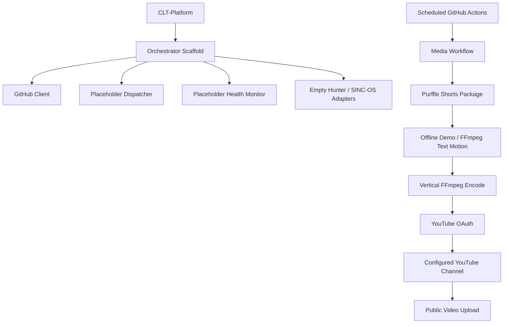

# CLT-Platform — Cloudy_Lap_top Ecosystem Scaffold

[](https://www.python.org/)
[](https://github.com/features/actions)
[](#proof-of-concept--enterprise-customization-readiness)

**CLT-Platform is an experimental repository containing two currently separate tracks: a placeholder ecosystem-orchestrator scaffold and a scheduled Shorts-generation/YouTube-upload workflow.**

The orchestrator classes are mostly stubs and are not connected to the media workflow. The media workflow can upload publicly when valid YouTube OAuth credentials are configured. It is not a private-review-first pipeline in its current code.

## 1. Project Overview & Problem Statement

The repository appears intended to coordinate several related projects and automate short-form video production. Current implementation evidence shows:

1. **Ecosystem orchestrator scaffold:** a minimal entry point, GitHub API client, placeholder dispatcher/health monitor/refactor engine, and empty adapters for Hunter AI and SINC-OS.
2. **Autonomous Media Pipeline:** a GitHub Actions workflow that invokes a generator package, encodes a vertical video with FFmpeg, authenticates to YouTube, verifies the configured channel, and uploads the result.

These are separate code paths. The orchestrator does not currently schedule or control the media pipeline, and the adapters do not integrate the referenced repositories.

### Architecture



## 2. Tech Stack & Versions

| Area | Technology |
|---|---|
| Workflow runtime | Python 3.12 for the media pipeline |
| Orchestrator scaffold | Python; GitHub REST access through `requests` |
| Media generation | `purffle-shorts` installed from a Git repository |
| Media download / platform access libraries | yt-dlp, Google API Python Client, google-auth-oauthlib, google-auth-httplib2 |
| Video processing | FFmpeg, libx264, AAC |
| YouTube integration | Official Google OAuth flow and YouTube Data API |
| CI / automation | GitHub Actions, setup-python, pip cache |

There is no root-level `requirements.txt` or dependency lockfile. The media track has its own unpinned/range-based [`autonomous-media-pipeline/requirements.txt`](autonomous-media-pipeline/requirements.txt). The orchestrator's GitHub client imports `requests`, but no root dependency manifest currently declares it.

## 3. Prerequisites & Dependencies

For the scheduled media workflow:

- GitHub Actions enabled.
- Python 3.12 runner.
- FFmpeg and DejaVu fonts (installed by the workflow).
- Google OAuth credentials authorized for the intended YouTube channel.
- A YouTube upload token or refresh token plus its matching OAuth client ID and secret.
- Optional hosted LLM and media-provider credentials. These are external services and may have usage charges.

For local development of the orchestrator scaffold:

- Python.
- `requests` installed separately (not declared in a root dependency file).

The scheduled workflow does not need a permanent server. It runs on GitHub-hosted runners and cleans its temporary working directory after the job.

## 4. Installation & Local Setup

Clone the repository:

```bash
git clone https://github.com/zopair/CLT-Platform.git
cd CLT-Platform
```

### Install media pipeline dependencies

```bash
python -m venv .venv
source .venv/bin/activate
python -m pip install --upgrade pip
python -m pip install -r autonomous-media-pipeline/requirements.txt
```

Install FFmpeg using your operating system's package manager.

### Inspect the orchestrator scaffold

```bash
python -m pip install requests
python main.py
```

This command only prints startup messages and instantiates the placeholder GitHub client/health monitor. It does not run a repository-wide monitoring or autonomous refactoring cycle.

### Generate a YouTube OAuth token

The helper `autonomous-media-pipeline/scripts/generate_token.py` uses Google's installed-app OAuth consent flow. It requires a valid OAuth client JSON and requests the YouTube upload scope. The resulting token must be stored in GitHub Secrets, not committed to the repository.

Do not run the scheduled publisher until the intended channel, visibility, content classification, source rights, and external provider costs have been explicitly reviewed.

## 5. Environment Variables

The workflow reads the following secrets/variables:

| Variable | Purpose |
|---|---|
| `YOUTUBE_TOKEN_JSON` | Authorized Google OAuth token JSON |
| `YOUTUBE_REFRESH_TOKEN` | Alternative refresh token |
| `YOUTUBE_CLIENT_ID`, `YOUTUBE_CLIENT_SECRET` | OAuth client pair required with the refresh token |
| `YOUTUBE_TARGET_HANDLE` | Target channel handle; workflow currently hard-codes `@Alyzopair` |
| `YOUTUBE_MADE_FOR_KIDS` | Workflow currently hard-codes `false`; this must be legally/classification-appropriate for each content type |
| `SHORTS_TOPIC` | Optional generation topic |
| `SHORTS_LANGUAGE` | Output language; defaults to Arabic |
| `SHORTS_DURATION` | Target duration; defaults to 45 seconds |
| `OPENAI_API_KEY`, `ANTHROPIC_API_KEY`, `GEMINI_API_KEY`, `GROQ_API_KEY`, `OPENROUTER_API_KEY`, `DEEPSEEK_API_KEY`, `MISTRAL_API_KEY`, `TOGETHER_API_KEY`, `XAI_API_KEY`, `LLM_API_KEY` | Optional external LLM provider credentials |
| `LLM_BASE_URL`, `LLM_MODEL` | Optional custom LLM endpoint/model |
| `PEXELS_API_KEY`, `PIXABAY_API_KEY`, `POLLINATIONS_API_KEY` | Optional media-generation/search provider credentials |
| `GITHUB_TOKEN` | Used by the separate orchestrator GitHub client when invoked |

The current workflow run history reviewed on 26 November shows the YouTube OAuth secrets were not configured: both token JSON and refresh-token/client credentials were empty. The configuration-validation step therefore stopped before generation or upload.

### Cost and privacy boundary

The workflow may use hosted LLM or media-provider APIs when their credentials are configured. Those services are not guaranteed to be free. Keep all such secrets unset unless the provider, pricing, data handling, and zero-budget implications have been explicitly approved.

## 6. Usage Guide & Core Features

### A. Scheduled media workflow

`.github/workflows/autonomous-media-pipeline.yml` runs:

- On pushes to `main`.
- On a schedule at five UTC times per day.
- On manual dispatch.

The workflow installs Python dependencies and FFmpeg, validates YouTube OAuth configuration, runs `process_and_publish.py`, then removes temporary media and caches.

### B. Actual media-generation behavior

The script currently:

1. Invokes the external `purffle-shorts` generator with niche-source mode and no direct upload.
2. If that command fails, attempts its bundled demo mode.
3. If no MP4 is found, creates a procedural text-motion fallback with FFmpeg.
4. Re-encodes the result to 1080×1920 vertical H.264/AAC.
5. Authenticates to YouTube and verifies that the account matches the configured target handle.
6. Uploads the generated video and verifies the returned video ID.

This is a generation-and-upload path. It does not currently download or process videos from `SOURCE_CHANNELS` or `authorized_sources.txt`; those values are not consumed by the current script/workflow.

### C. Public-upload warning

<badge color="danger">Current code uploads publicly</badge>

The upload request sets `privacyStatus: "public"`. This conflicts with the older nested README's statement that uploads default to private. The current implementation has no private-review approval gate before upload.

A successful scheduled run with valid credentials can therefore publish a video publicly to the hard-coded target channel. The `YOUTUBE_MADE_FOR_KIDS` value is also hard-coded to `false`; this must not be treated as a universal content classification.

### D. Fallback behavior

If the primary generator fails, the script attempts the generator's offline demo. If that also fails, it renders a simple procedural text-motion Short using FFmpeg. This fallback is not evidence of a fully produced or editorially reviewed video.

### E. Orchestrator scaffold

- `main.py` instantiates `GitHubClient` and `HealthMonitor`, then prints a monitoring message.
- `Dispatcher.assign_task` only prints a task assignment.
- `HealthMonitor.evaluate` returns a fixed healthy score of 100.
- `RefactorEngine.analyze` returns an empty action list and `optimized: true`.
- `HunterAIAdapter` and `SINCOSAdapter` are empty classes.

These components are placeholders, not a functioning autonomous control plane.

## 7. Live Demo & Screenshots

There is no hosted application UI or public demo website in the current repository tree.

The primary operational evidence is the [Autonomous Media Pipeline workflow history](https://github.com/zopair/CLT-Platform/actions/workflows/autonomous-media-pipeline.yml). Recent scheduled runs failed at the configuration-validation step because YouTube OAuth credentials were absent; generation and upload were skipped.

No successful video publication is claimed by this README. No generated video artifact is retained by the workflow; temporary media is removed in its cleanup step.

## 8. Testing & Verification

No dedicated unit-test suite or automated test workflow was found in the reviewed tree. The media workflow performs configuration validation, generation, encoding, and YouTube upload, but does not run a test suite before the upload step.

### CI evidence observed during this review

- Latest scheduled run [#45744036078](https://github.com/zopair/CLT-Platform/actions/runs/45744036078) on 26 November 2026 — Failure.
- The job installed FFmpeg and Python dependencies successfully.
- It failed at `Validate configuration without exposing secrets` because neither `YOUTUBE_TOKEN_JSON` nor the required refresh-token/client credential set was present.
- `Generate, process, and publish` was skipped. No upload occurred in that run.
- Several preceding scheduled runs on 22–25 November also failed.

This failure is a credential-configuration stop, not evidence that the generator or upload path passed end-to-end.

## Proof of Concept & Enterprise Customization Readiness

**Status: Experimental scaffold. The media workflow is configured but currently blocked at OAuth validation; the ecosystem orchestrator is mostly placeholder code.**

| Capability | Verified state / boundary |
|---|---|
| Scheduled GitHub Actions workflow | Configured; scheduled and push-triggered |
| Media generation | External `purffle-shorts` command plus offline/demo and FFmpeg fallback paths |
| Vertical encoding | FFmpeg 1080×1920 H.264/AAC path implemented |
| YouTube OAuth | Code supports token JSON or refresh-token/client credentials; current workflow run lacks credentials |
| Channel verification | Script checks authenticated channel against `@Alyzopair` |
| Upload privacy | Current code sets videos to public; no human review gate |
| Source-channel processing | Not implemented despite the unused authorized-source configuration |
| Hosted LLM providers | Optional external keys; may incur charges |
| Orchestrator | Entry point and placeholder classes only |
| GitHub API client | Basic `requests` wrapper; no retry/rate-limit policy or test evidence |
| Tests | No dedicated tests found |
| License | No root `LICENSE` file; external generator/package terms need review |

### Required engineering gates before relying on automation

1. Resolve the public-upload versus private-review policy in code, not only in documentation.
2. Add an explicit human approval step before any public YouTube upload.
3. Remove or correctly implement unused `SOURCE_CHANNELS` and `authorized_sources.txt` configuration.
4. Confirm OAuth scope, target channel identity, token rotation, and upload privacy behavior with a controlled test.
5. Add cost controls or keep all hosted provider keys disabled for zero-budget operation.
6. Add tests for generator fallback, output validation, OAuth failure, channel mismatch, upload visibility, and cleanup.
7. Replace placeholder orchestrator components with bounded, tested interfaces before claiming cross-repository autonomy.
8. Add root dependency management and select a project license after reviewing third-party terms.

## Intellectual Property & Authorship

Project authorship and attribution: **Aly Hussein Zopair (علي حسين زبير ALY HUSSEIN ZOPAIR)**.

This attribution does not replace a software license or grant rights to generated media, third-party generator packages, source videos, fonts, music, or platform assets. Verify the current upstream license and all media rights before publication.
